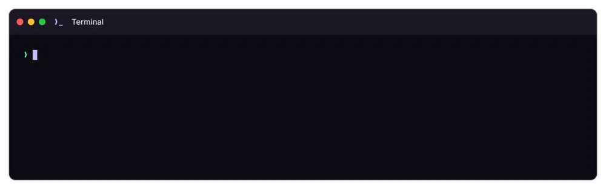

<div align="center">

# comfynkg

**Run several ComfyUI instances on one Linux server from a single YAML file.**

systemd units · drain-aware restarts · canary updates with rollback · model sync · one status for every server

[](https://github.com/nakagawadev/comfynkg/releases)
[](LICENSE)



</div>

comfynkg turns `/etc/comfynkg.yaml` into systemd units, restarts instances without dropping queued prompts, updates ComfyUI and custom nodes with a canary and automatic rollback, and keeps model folders in sync across servers. It wraps [comfy-cli](https://github.com/Comfy-Org/comfy-cli) and ships as one static Go binary.

> A personal tool, shared as is. It runs as root and manages systemd units on the servers it touches. Read [how it works](docs/how-it-works.md) and [security](docs/security.md) before pointing it at anything you care about.

## Why

Running one ComfyUI is easy. Running five on a GPU server tends to end up as hand-written units, copy-pasted flags, restart scripts that kill whatever is generating, and `rsync` loops for models. comfynkg replaces that with one file you can read and diff:

```yaml
root: /home/comfy/instances
flags: --disable-metadata
models:
  image: /home/comfy/config/image/extra_model_paths.yaml

comfy_a:
  type: image
  port: 8188
  gpu: 0
  enabled: true

comfy_b:
  type: image
  port: 8189
  gpu: 1
  flags: --lowvram
  enabled: false
```

```console
# comfynkg apply
> node0:8188 (comfy_a) unit created
> node0:8189 (comfy_b) unit created
> node0:8188 (comfy_a) enabled, starting... ok (19s)
done: 0 restarted, 1 started, 1 unchanged
```

## Features

- **Declarative**: `apply` makes systemd match the file. Each instance gets its own unit and venv, on the GPU you pick (several can share one).
- **Restarts that wait**: `restart --wait` waits for the queue to empty before restarting. With the [comfyui_nakagawa](https://github.com/nakagawadev/comfyui_nakagawa) node installed, the instance also drains first (new prompts get `503`); a timeout turns drain off and skips it.
- **Safe updates**: `update core|nodes` takes a snapshot, updates one instance first, checks it comes back healthy and rolls back if not.
- **Migration**: `takeover` swaps an existing hand-made unit for a managed one on the same port.
- **One view of every server**: `status` shows each instance's state, GPU, VRAM, queue, prompts ok/error, uptime and health, plus the other servers listed in `hosts:` (asked over SSH). `status -w` keeps it live. Read-only commands work as any user.
- **Model sync**: one server pushes model folders to the others with `rsync` over SSH, with a guard that refuses `--delete` when the source looks empty.
- **Private by default**: ComfyUI listens on `127.0.0.1` and the server's [Tailscale](https://tailscale.com) address only.
- **Unprivileged instances**: every process and file belongs to one ordinary user. Root never reads or writes inside that user's folders directly.

## Requirements

- Linux with systemd, amd64 or arm64.
- [uv](https://docs.astral.sh/uv/) in `/usr/local/bin` (install.sh puts it there; comfy-cli is installed with it).
- Tailscale, up on the server.
- NVIDIA GPUs.
- Optional: the [comfyui_nakagawa](https://github.com/nakagawadev/comfyui_nakagawa) custom node, for drain mode, and RSS and prompt ok/error counts in `status`. Without it, restarts just wait for the queue.

## Install

As root, on each server:

```bash
curl -fsSL https://raw.githubusercontent.com/nakagawadev/comfynkg/main/install.sh | sh
```

[install.sh](install.sh) installs uv (if missing), comfy-cli for every user and the latest comfynkg release for your architecture, checked against its `SHA256SUMS`. Running it again upgrades everything. To read it first, or to pick a release:

```bash
curl -fsSLO https://raw.githubusercontent.com/nakagawadev/comfynkg/main/install.sh
less install.sh
VERSION=v0.2.2 sh install.sh
```

Later updates of comfynkg alone: `comfynkg self-update` (or `self-update v0.2.2`).

## Quick start

```bash
# write the config (root-owned, not writable by others, or comfynkg refuses it)
install -o root -g root -m 644 /dev/null /etc/comfynkg.yaml
$EDITOR /etc/comfynkg.yaml

comfynkg create comfy_a --type image --port 8188 --gpu 0   # installs ComfyUI with comfy-cli
comfynkg enable comfy_a                                    # sets enabled: true and applies
comfynkg status
```

## Everyday commands

| Command | Does |
|---|---|
| `status [-w]` | Every instance, here and on the servers in `hosts:`: state, GPU, VRAM, queue, ok/errors, uptime, health; `-w` refreshes every 2 s |
| `apply [--dry-run]` | Make systemd match the file |
| `restart <inst\|all> --wait` | Drain, wait for the queue, restart |
| `logs <inst> -f` | Follow the instance's journal |
| `node install <inst\|all> <node>` | Install a custom node |
| `update nodes <inst\|all>` | Canary update with rollback |
| `takeover <inst> --old <unit>` | Replace a legacy unit |
| `sync status` | Last sync round per model type |

Full list, flags, output and exit codes: [docs/commands.md](docs/commands.md).

## Docs

- [Config](docs/config.md): `/etc/comfynkg.yaml`, key by key
- [Commands](docs/commands.md): every command, output and exit codes
- [How it works](docs/how-it-works.md): units, restarts and drain, updates, takeover, sync
- [Security](docs/security.md): what runs as root and what doesn't

## Development

```bash
make lint test   # gofmt, go vet, staticcheck, unit tests
make build       # dist/comfynkg-linux-{amd64,arm64} + SHA256SUMS
make dev-vm e2e  # end-to-end tests as root in an OrbStack VM (RUN=TestRename for one)
make e2e-quick   # the same without the slow install/network parts, while working
```


## License

MIT, see [LICENSE](LICENSE).
